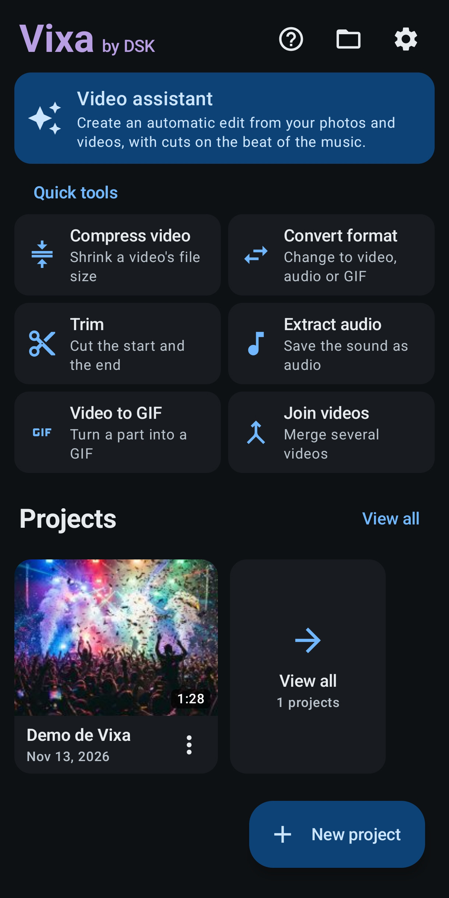
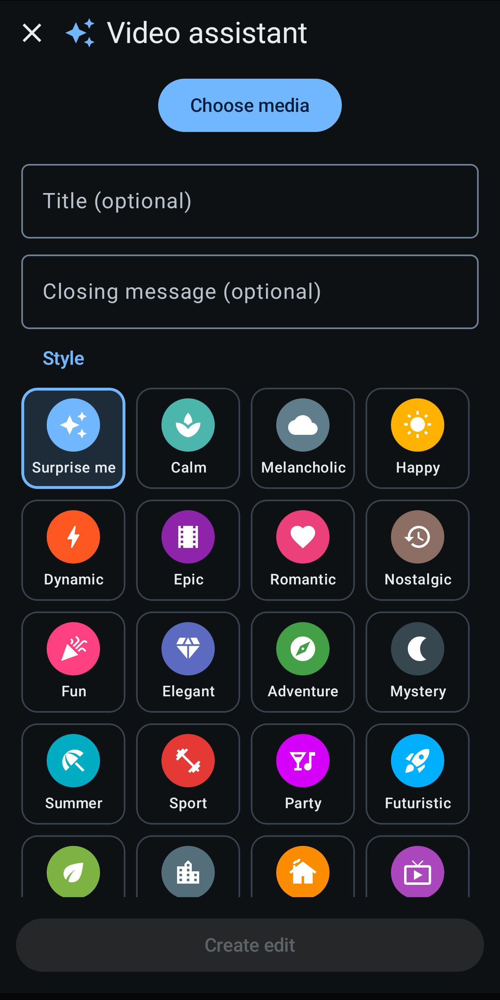
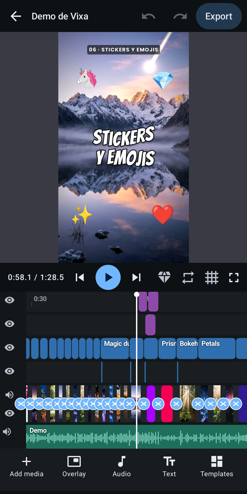
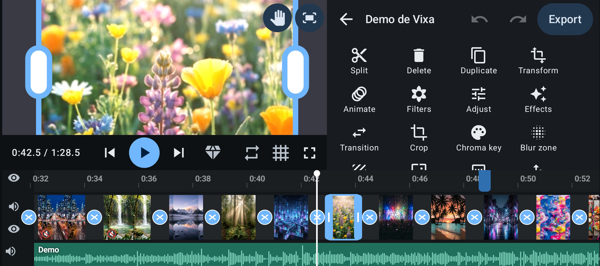

<div align="center">

# 🎬 Vixa

### The Android video editor that has it all… and works with one hand.

**Pick your photos and videos, pick a style, and the Assistant cuts the video to the beat of the music.**
**Want to take control? There is a pro-grade editor in your pocket.**

[🇪🇸 Español](README.md) · [🇬🇧 English](README.en.md)

<br>


[](LICENSE)


</div>

---

<p align="center">
  
  
  
</p>

<p align="center">
  
</p>

## ✨ What is Vixa?

**Vixa** is a native Android video editor packed with features and built around one simple idea: get a
spectacular video in a minute and still be able to tweak absolutely everything.

- 🪄 **Video assistant**: pick your media, a style (there are **27**) and the music. Vixa detects the beat, cuts on it and adds transitions, camera moves, color, effects, a title and an outro. The result is a regular project that opens in the editor.
- 🧬 **Photo morph**: 2 or more photos that turn into each other for real (MediaPipe face mesh, eyes on eyes; not a crossfade). Automatic with faces, plus a points-and-framing editor for any image; optional slow zoom and back-and-forth.
- 📖 **Built-in guide** with search and index.
- 🎞️ **Full multitrack editor**: timeline with video, overlays, audio, text, stickers and adjustment layers.
- 🎛️ **Pro / Normal mode**: a button in the editor shows or hides the advanced tools (on by default; remembered). With **Draw a path** any animatable element follows your finger's stroke, and the transport bar can be dragged to split the screen between preview and timeline.
- 🌈 **Loads of content**: **85 transitions**, **180+ effects** (custom shaders), **100+ filters** and LUTs, **150+ animated text templates**, **120 vector shapes** and emojis.
- 🤖 **On-device AI**: automatic subtitles, background removal without chroma key, object tracking, voice enhancement and separation… all local, after a one-time model download.
- 🎚️ **Audio**: equalizer, voice changer, noise reduction, automatic music ducking, voice-over.
- 📤 **Export**: video up to 4K, GIF, audio only, social media presets.
- 🌐 **Free online resources**: photos, videos, music and sound effects from Pixabay, Pexels, Unsplash, Giphy, Jamendo, Freesound and more.
- 🔒 **Almost everything works offline.**

## 🧰 Highlights

| | |
|---|---|
| **🎬 Assistant** | 27 styles (Epic, Romantic, Party, Gaming, Wedding, Lo-fi…), beat-synced cuts, climax sections, beat effects, speed ramps and automatic Jamendo music or your own song. |
| **✂️ Editing** | Split, trim, snapping, grouping, copy attributes, speed curves, reverse, freeze frame, stabilization, keyframes, masks, chroma key, blur zones. |
| **🪩 Effects & transitions** | Aurora, fireworks, rain on glass, oil paint, comic, glitch, hologram, CRT, drone HUD… and 85 transitions (ink, shatter, iris, drip…). |
| **🔤 Text** | Templates for titles, intros, lower thirds, quotes, countdowns and styled subtitles; per-letter animations; 24 fonts. |
| **🧠 Local AI** | Subtitles (Whisper), voice detection, person cutout, object tracking, clean voice and voice/music separation. |
| **📦 Projects** | Autosave, undo history, 10-day trash, `.vixa` export/import, project templates. |

## 🚀 Build and run

**Requirements:** a recent Android Studio, JDK 17+ (the bundled one is fine) and an **arm64** phone/emulator running Android 8.0 (API 26) or newer.

```bash
git clone https://github.com/dskmusic/vixa.git
cd vixa
```

1. Open the folder in **Android Studio** and wait for the Gradle sync to finish.
2. *(Optional but recommended)* Copy `local.properties.example` to `local.properties` and fill in your free API keys (see the table below). **Without keys the app still builds and runs**: it simply asks for them in *Settings → Customize APIs*, with links to each service.
3. Hit **Run ▶** on the `app` module.

> Only the **arm64-v8a** architecture is packaged (current phones) to keep the APK small. To test on an x86_64 emulator, see the comments in `app/build.gradle.kts`.

## 🔑 API keys (free and optional)

Each service gives you a free key. Paste it into `local.properties` (at build time) or directly into **Settings → Customize APIs** (in the app).

| Service | Used for | Get the key |
|---|---|---|
| Pixabay | Photos, illustrations and videos | [pixabay.com/api/docs](https://pixabay.com/api/docs/) |
| Pexels | Photos and videos | [pexels.com/api](https://www.pexels.com/api/) |
| Unsplash | Photos | [unsplash.com/developers](https://unsplash.com/developers) |
| Wallhaven | Wallpapers | [wallhaven.cc](https://wallhaven.cc/settings/account) |
| Coverr | Videos | [api.coverr.co/docs](https://api.coverr.co/docs/) |
| Giphy | GIFs and stickers | [developers.giphy.com](https://developers.giphy.com/) |
| Klipy | GIFs and stickers | [klipy.com](https://klipy.com) |
| Jamendo | Instrumental music for the assistant | [developer.jamendo.com](https://developer.jamendo.com/v3.0) |
| Freesound | Sound effects | [freesound.org/apiv2/apply](https://freesound.org/apiv2/apply/) |

## 🏗️ How it is built

A single `app` module, no Hilt or Room: **Kotlin + Jetpack Compose (Material 3)**, **AndroidX Media3** (playback, composition and export), effects and transitions written in **GLSL (OpenGL ES 2.0)**, projects as JSON (`kotlinx.serialization`) and settings in DataStore. AI runs on **ONNX Runtime / sherpa-onnx / MediaPipe / ML Kit**. See [`docs/ARQUITECTURA.md`](docs/ARQUITECTURA.md) (Spanish) for details.

## 🤝 Contributing

Ideas and pull requests are welcome! Open an issue to report a bug or suggest an improvement. New effects, transitions and templates are just data entries in `engine/Registry.kt` or `engine/Templates.kt` (with their names in `res/values*/strings.xml`).

## 📄 License and attribution

Vixa is released under the **[Apache License 2.0](LICENSE)**: you may use, modify and redistribute it, **keeping the [`NOTICE`](NOTICE) file and crediting the original author** (*Vixa by DSK*) with a link to [the author's website](https://www.dskmusic.com/dsk_dev_redirect.php).

Online resources (Pixabay, Pexels, Jamendo…) have their own licenses: check them before publishing a video. AI models are downloaded from their official sources and keep their own licenses.

<div align="center">

**Made with ❤️ by [DSK](https://www.dskmusic.com/dsk_dev_redirect.php)**

⭐ *If you like Vixa, leave a star on the repository.*

</div>
