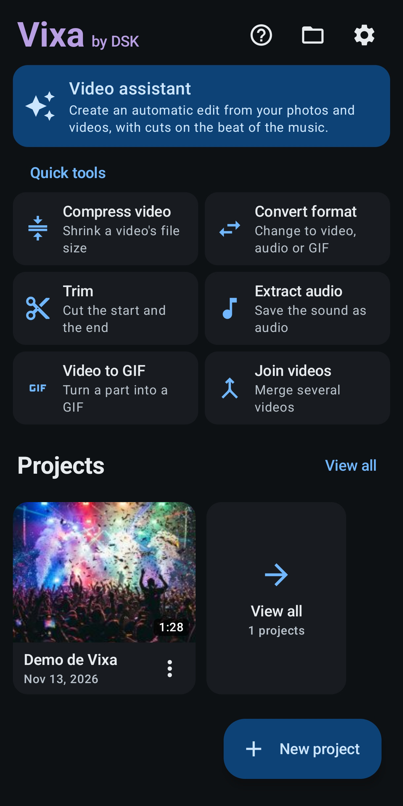
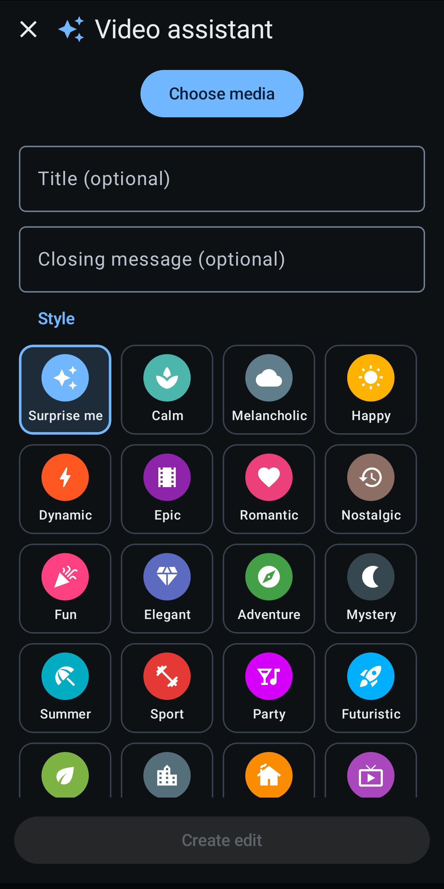
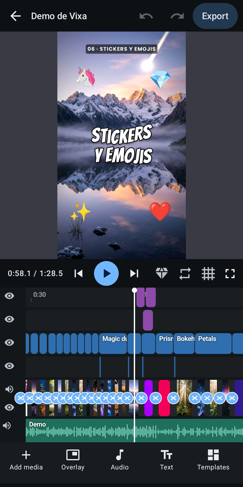
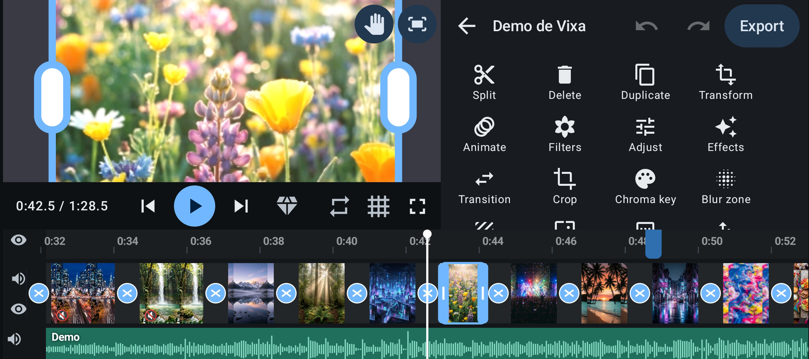

<div align="center">

# 🎬 Vixa

### El editor de vídeo para Android que lo tiene todo… y se maneja con una mano.

**Elige tus fotos y vídeos, elige un estilo, y el Asistente monta el vídeo al ritmo de la música.**
**Y si quieres ponerte a editar, tienes un editor profesional en tu bolsillo.**

[🇪🇸 Español](README.md) · [🇬🇧 English](README.en.md)

<br>


[](LICENSE)


</div>

---

<p align="center">
  
  
  
</p>

<p align="center">
  
</p>

## ✨ ¿Qué es Vixa?

**Vixa** es un editor de vídeo nativo para Android con **muchísimas funciones** y un enfoque muy sencillo: que en
un minuto tengas un vídeo espectacular y, si quieres, puedas retocar absolutamente todo.

- 🪄 **Asistente de vídeo**: eliges tus medios, un estilo (hay **27**) y la música. Vixa detecta el ritmo, corta al compás y monta transiciones, cámara, color, efectos, título y cierre. El resultado es un proyecto normal que se abre en el editor.
- 🧬 **Morph entre fotos**: 2 o más fotos que se transforman una en otra de verdad (malla de la cara con MediaPipe, ojos con ojos; no es un fundido). Automático con caras y editor de puntos y encuadre para cualquier imagen; zoom lento e ida y vuelta opcionales.
- 📖 **Guía integrada** con buscador e índice.
- 🎞️ **Editor multipista completo**: línea de tiempo con vídeo, superposiciones, audio, texto, stickers y capas de ajuste.
- 🎛️ **Modo Pro / Normal**: un botón en el editor muestra u oculta las herramientas avanzadas (activado por defecto; se recuerda). Con **Dibujar camino** cualquier elemento animable sigue el trazo de tu dedo, y la barra de transporte se arrastra para repartir la pantalla entre vista previa y línea de tiempo.
- 🌈 **Contenido de sobra**: **85 transiciones**, **180+ efectos** (shaders propios), **100+ filtros** y LUT, **150+ plantillas de texto** animadas, **120 formas** vectoriales y emojis.
- 🤖 **IA en tu móvil**: subtítulos automáticos, quitar fondos sin croma, seguimiento de objetos, mejora y separación de voz… todo local, tras descargar los modelos una sola vez.
- 🎚️ **Audio**: ecualizador, cambio de voz, reducción de ruido, atenuación automática de la música, voz en off.
- 📤 **Exportación**: vídeo hasta 4K, GIF, solo audio, plantillas para redes sociales.
- 🌐 **Recursos online gratis**: fotos, vídeos, música y efectos de sonido de Pixabay, Pexels, Unsplash, Giphy, Jamendo, Freesound y más.
- 🔒 **Casi todo funciona sin conexión.**

## 🧰 Funciones destacadas

| | |
|---|---|
| **🎬 Asistente** | 27 estilos (Épico, Romántico, Fiesta, Gaming, Boda, Lo-fi…), cortes al pulso, secciones con clímax, efectos a ritmo, rampas de velocidad y música automática de Jamendo o tuya. |
| **✂️ Edición** | Dividir, recortar, mover con imán, agrupar, copiar atributos, velocidad con curva, inversa, congelar fotograma, estabilización, fotogramas clave, máscaras, croma, zonas de desenfoque. |
| **🪩 Efectos y transiciones** | Aurora, fuegos artificiales, lluvia en cristal, óleo, cómic, glitch, holograma, CRT, drones HUD… y 85 transiciones (tinta, cristal roto, barrido, iris, goteo…). |
| **🔤 Texto** | Plantillas de títulos, intros, tercios inferiores, citas, cuentas atrás y subtítulos con estilo; animaciones por letra; 24 fuentes. |
| **🧠 IA local** | Subtítulos (Whisper), detección de voz, recorte de personas, seguimiento de objetos, voz limpia y separación de voz/música. |
| **📦 Proyectos** | Autoguardado, historial con deshacer, papelera de 10 días, exportar/importar `.vixa`, plantillas de proyecto. |

## 🚀 Compilar y ejecutar

**Requisitos:** Android Studio (versión reciente), JDK 17+ (el que trae Android Studio vale) y un móvil/emulador **arm64** con Android 8.0 (API 26) o superior.

```bash
git clone https://github.com/dskmusic/vixa.git
cd vixa
```

1. Abre la carpeta en **Android Studio** y espera a que termine la sincronización de Gradle.
2. *(Opcional pero recomendado)* Copia `local.properties.example` como `local.properties` y rellena tus claves de API gratuitas (mira la tabla de abajo). **Sin claves la app compila y funciona igual**: simplemente las pedirá en *Ajustes → Personalizar APIs*, con enlaces a cada servicio.
3. Pulsa **Run ▶** sobre el módulo `app`.

> El proyecto solo empaqueta la arquitectura **arm64-v8a** (los móviles actuales) para reducir el tamaño. Para probar en un emulador x86_64 mira los comentarios de `app/build.gradle.kts`.

## 🔑 Claves de API (gratuitas y opcionales)

Cada servicio te da su clave gratis. Pégala en `local.properties` (al compilar) o directamente en **Ajustes → Personalizar APIs** (en la app).

| Servicio | Para qué | Conseguir la clave |
|---|---|---|
| Pixabay | Fotos, ilustraciones y vídeos | [pixabay.com/api/docs](https://pixabay.com/api/docs/) |
| Pexels | Fotos y vídeos | [pexels.com/api](https://www.pexels.com/api/) |
| Unsplash | Fotos | [unsplash.com/developers](https://unsplash.com/developers) |
| Wallhaven | Fondos | [wallhaven.cc](https://wallhaven.cc/settings/account) |
| Coverr | Vídeos | [api.coverr.co/docs](https://api.coverr.co/docs/) |
| Giphy | GIF y stickers | [developers.giphy.com](https://developers.giphy.com/) |
| Klipy | GIF y stickers | [klipy.com](https://klipy.com) |
| Jamendo | Música instrumental del asistente | [developer.jamendo.com](https://developer.jamendo.com/v3.0) |
| Freesound | Efectos de sonido | [freesound.org/apiv2/apply](https://freesound.org/apiv2/apply/) |

## 🏗️ Cómo está hecho

Un solo módulo `app`, sin Hilt ni Room: **Kotlin + Jetpack Compose (Material 3)**, **AndroidX Media3** (reproducción, composición y exportación), efectos y transiciones escritos en **GLSL (OpenGL ES 2.0)**, proyectos en JSON (`kotlinx.serialization`) y ajustes en DataStore. La IA corre con **ONNX Runtime / sherpa-onnx / MediaPipe / ML Kit**. Detalles en [`docs/ARQUITECTURA.md`](docs/ARQUITECTURA.md).

## 🤝 Contribuir

¡Las ideas y los *pull requests* son bienvenidos! Abre un *issue* para contar un fallo o proponer una mejora. Si añades efectos, transiciones o plantillas, cada uno es una entrada de datos en `engine/Registry.kt` o `engine/Templates.kt` (con su nombre en `res/values*/strings.xml`).

## 📄 Licencia y atribución

Vixa se distribuye bajo la **[Licencia Apache 2.0](LICENSE)**: puedes usarlo, modificarlo y redistribuirlo, **conservando el archivo [`NOTICE`](NOTICE) y mencionando al autor original** (*Vixa by DSK*) con un enlace a [la web del autor](https://www.dskmusic.com/dsk_dev_redirect.php).

Los recursos online (Pixabay, Pexels, Jamendo…) tienen sus propias licencias: revísalas antes de publicar un vídeo. Los modelos de IA se descargan de sus sitios oficiales y conservan sus licencias.

<div align="center">

**Hecho con ❤️ por [DSK](https://www.dskmusic.com/dsk_dev_redirect.php)**

⭐ *Si te gusta Vixa, deja una estrella en el repositorio.*

</div>
